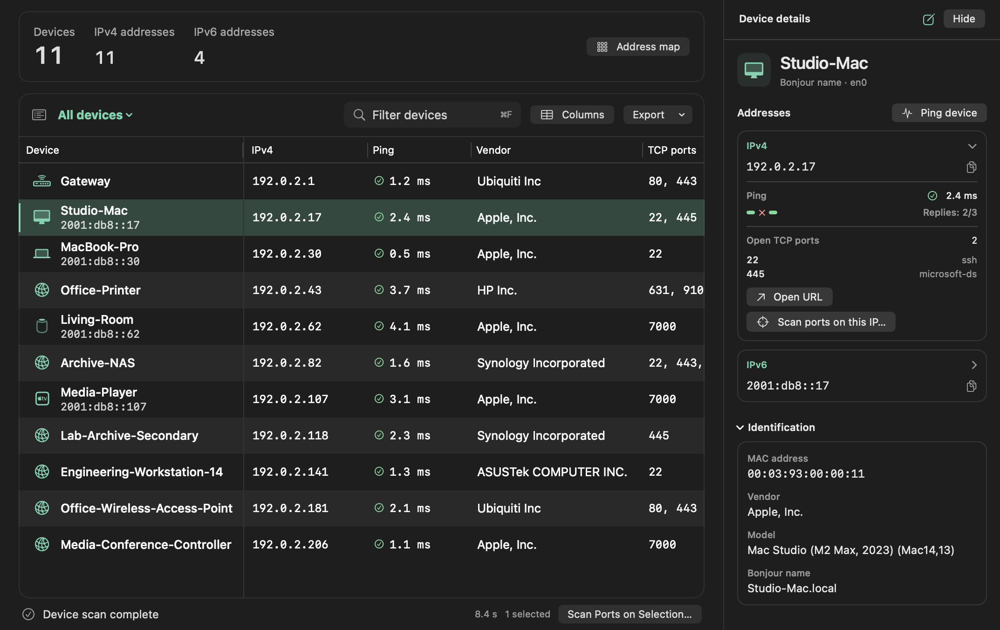
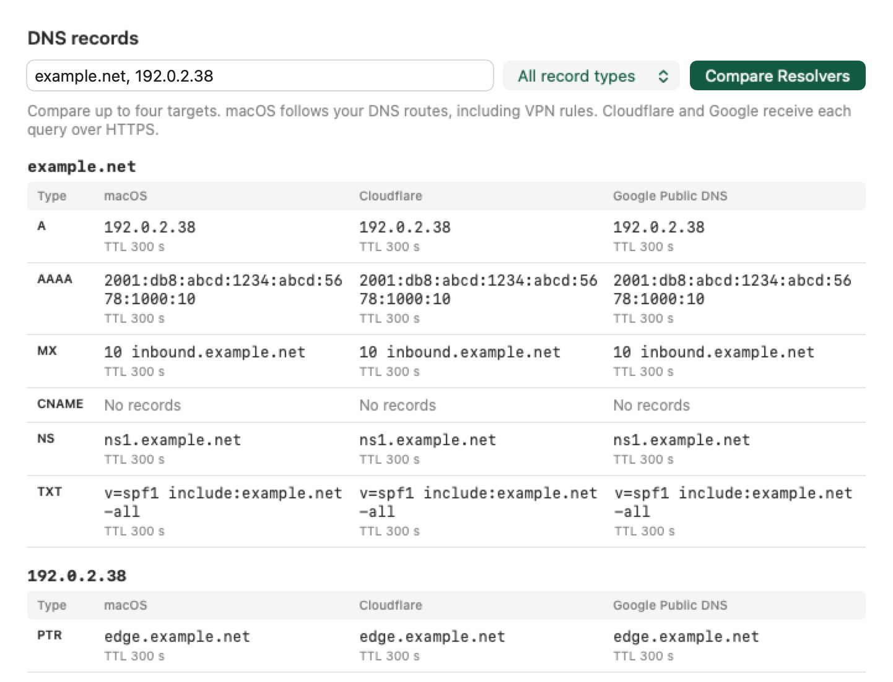

# MScan

[简体中文](README.zh-CN.md) · [Download for macOS](https://github.com/nanguoyu/MScan-app/releases/latest)

MScan is a native macOS app for discovering devices on a local network. Choose a network interface, scan its IPv4 subnet and IPv6 neighbors, then select a device to inspect its addresses, ping times and open TCP ports.



*Example scan. The device names, addresses and measurements in these screenshots are sample data.*

## Install and update

MScan runs on macOS 14 or later, on Apple silicon and Intel. Download the macOS universal ZIP from the latest release, unzip it and move **MScan.app** to Applications. The public build is ad-hoc signed and has no Apple notarization. If Gatekeeper blocks the download, you can build the app locally using the instructions below. [Latest release](https://github.com/nanguoyu/MScan-app/releases/latest)

With automatic checks enabled, MScan checks GitHub for a new stable release daily. If a check fails, it can retry after an hour. You can also choose **Check for Updates** from the MScan menu. When a release is available, you choose whether to download and install it.

## Run a scan

1. Select the Wi-Fi, Ethernet or virtual interface you want to inspect. Choose **Local network**, **IPv6 neighbors** or a custom address range.
2. Press **⌘R** to start. Allow local network access if macOS asks. For repeated scans, enable **Continuous scan**.
3. Select a device to see its addresses and ping results. From its inspector, start a TCP port scan for one address, or select multiple devices in the table to scan their ports together.

Use **⌘F** to find a device by name, address or vendor. You can attach a name and notes to a device, export the table as delimited text, or print it to PDF. In **MScan → Settings**, choose English, Simplified Chinese or the system language.

On macOS 27, MAC addresses can be hidden from builds without a provisioned Network Topology Observation entitlement. The public build can still discover IP addresses and check ports, but vendor information may be missing. [Apple’s explanation](https://developer.apple.com/forums/thread/841958)

## Network Diagnostics

Open **Network Diagnostics** in the sidebar to compare what different services see from your Mac. For example, the DNS view places the system resolver beside Cloudflare and Google, so you can see whether a hostname resolves differently over your VPN.



| Tool | What it shows |
| --- | --- |
| Public IP | Compare the current connection and up to eight public addresses across five providers. Open an approximate location on OpenStreetMap when a provider returns coordinates. |
| Registration and routing | See the registered network and the prefix and origin ASN observed in BGP. |
| DNS | Compare forward and reverse records for up to four targets. Four separate DNS observations help identify the resolvers used by your connection. |
| WebRTC | Compare local WebKit ICE candidates with mapped addresses from Cloudflare, Google and Twilio. [Example results](Docs/webrtc-en.png) |
| Connectivity and speed | Check HTTPS reachability to Apple, Cloudflare, Google and Mozilla, or measure latency and throughput to Cloudflare. |

MScan keeps the device list on your Mac. You can export a copy when you want to share it. Public diagnostics contact services when you run a test. A selected provider receives the query and sees the IP used to reach it. Optional provider keys are stored in the macOS Keychain. Device notes can be synced by choosing a shared folder in Settings.

## Build from source

With Xcode installed, run these commands in Terminal.

```sh
git clone https://github.com/nanguoyu/MScan-app.git
cd MScan-app
./Scripts/build-app.sh --local
open dist/MScan.app
```

To run the test suite, use `swift test`. To work in Xcode, open `MScan.xcodeproj` and select the **MScan Mac** scheme.

MScan source code is available under the [MIT License](LICENSE). The bundled vendor and device catalogs have their own [source notices](Sources/MScanCore/Resources/CatalogSources.txt).
