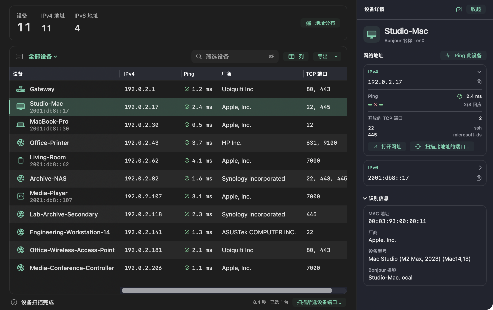
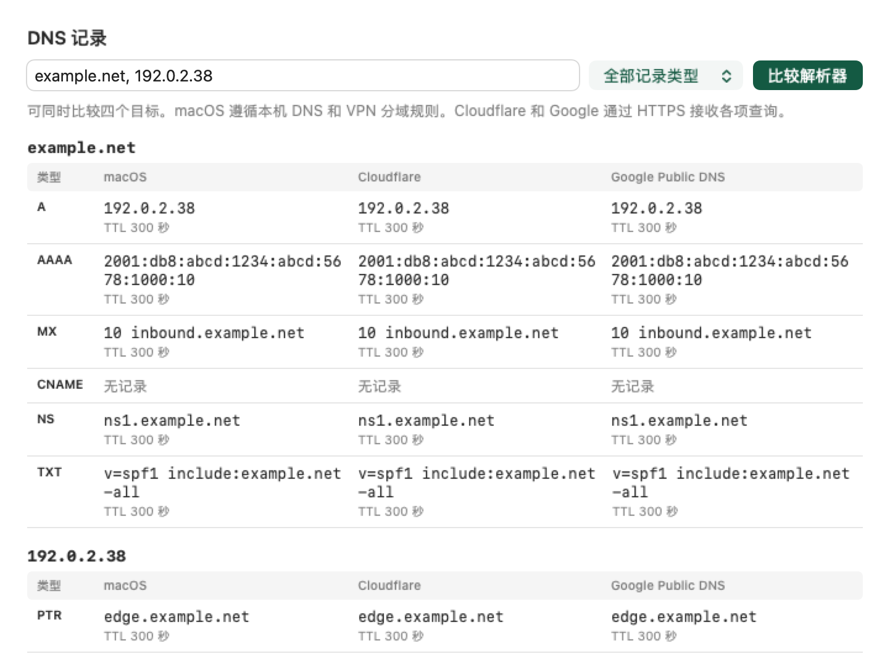

# MScan

[English](README.md) · [下载 macOS 版](https://github.com/nanguoyu/MScan-app/releases/latest)

MScan 是一款原生 macOS 局域网扫描工具。选好网络接口后，可以同时发现 IPv4 子网中的设备和 IPv6 邻居。点选一台设备，即可查看它的地址、Ping 延迟和开放的 TCP 端口。



*扫描示例。截图中的设备名称、地址和测量结果均为示例数据。*

## 安装与更新

MScan 支持搭载 Apple 芯片或 Intel 处理器、运行 macOS 14 及以上版本的 Mac。在最新发行版中下载 macOS 通用 ZIP 包，解压后将 **MScan.app** 移到「应用程序」。公开构建使用 ad-hoc 签名，未经 Apple 公证。如果系统拦截下载的应用，可以按下文步骤在本机从源码构建。[最新发行版](https://github.com/nanguoyu/MScan-app/releases/latest)

启用自动检查后，MScan 每天检查 GitHub Releases 上是否有新的稳定版。如果查询失败，一小时后可以重试。也可以从 MScan 菜单选择「检查更新」。发现新版本后，由你决定是否下载并安装。

## 扫描设备

1. 选择 Wi-Fi、以太网或虚拟网络接口，再选择本地网络、IPv6 邻居或指定地址范围。
2. 按 **⌘R** 开始扫描。如果 macOS 请求访问本地网络，请允许。需要持续观察时，打开「实时扫描」。
3. 点选一台设备查看地址和 Ping 结果。可在详情中扫描某个地址的 TCP 端口，也可以在表格中多选设备，一起扫描端口。

按 **⌘F** 可按名称、地址或厂商查找设备。可以给设备添加别名和备注，把列表导出为分隔文本文件，或通过打印面板保存为 PDF。在 **MScan → 设置** 中，可选择跟随系统、简体中文或 English。

macOS 27 可能向未获网络拓扑观测授权的应用隐藏 MAC 地址。公开构建仍可发现 IP 地址和检查端口，但部分设备的厂商信息可能为空。[Apple 的说明](https://developer.apple.com/forums/thread/841958)

## 网络诊断

从侧栏打开「网络诊断」，即可比较不同服务在这台 Mac 上观察到的结果。例如，DNS 页将系统解析器、Cloudflare 和 Google 的回答并排显示，方便查看 VPN 域名在不同解析路径上是否返回了不同地址。



| 工具 | 可查看的内容 |
| --- | --- |
| 公网 IP | 通过五个数据源对照本机出口和最多八个公网地址。如果数据源返回坐标，可以在 OpenStreetMap 查看估算位置。 |
| 注册与路由 | 查看地址的注册信息，以及 BGP 观测到的网络前缀和起源自治系统编号。 |
| DNS | 最多同时查询四个目标的正向和反向记录。四个独立观测来源可帮助识别当前连接使用的递归解析器。 |
| WebRTC | 将 WebKit 本机 ICE 候选地址与 Cloudflare、Google、Twilio 返回的映射地址对照。[查看示例](Docs/webrtc-zh.png) |
| 连通性与测速 | 检查到 Apple、Cloudflare、Google 和 Mozilla 的 HTTPS 连通性，也可以测量到 Cloudflare 的延迟和吞吐率。 |

设备列表保留在本机。需要分享时，可以导出一份副本。运行公网诊断时，所选服务商会收到查询内容，并看到连接使用的出口地址。可选的 API 密钥保存在 macOS 钥匙串中。若要同步设备备注，可在「设置」中选择共享文件夹。

## 从源码构建

安装 Xcode 后，在终端中运行以下命令。

```sh
git clone https://github.com/nanguoyu/MScan-app.git
cd MScan-app
./Scripts/build-app.sh --local
open dist/MScan.app
```

运行 `swift test` 可执行测试。使用 Xcode 开发时，打开 `MScan.xcodeproj`，选择 **MScan Mac** 方案。

MScan 源码采用 [MIT 许可证](LICENSE)。内置厂商和设备型号目录的来源及许可见[数据来源说明](Sources/MScanCore/Resources/CatalogSources.txt)。
